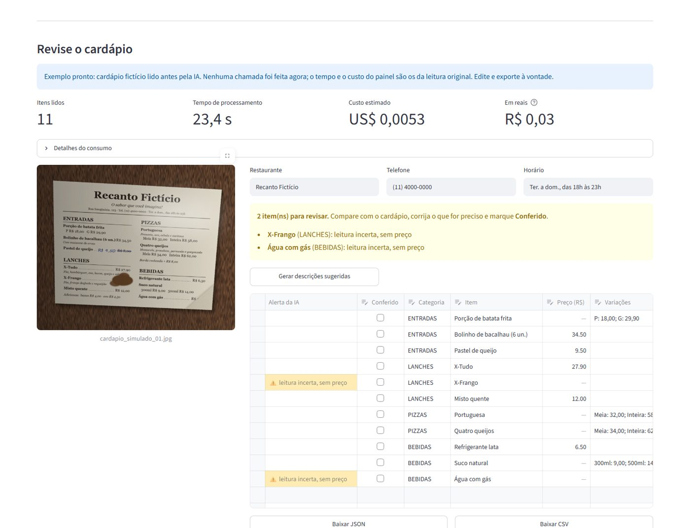
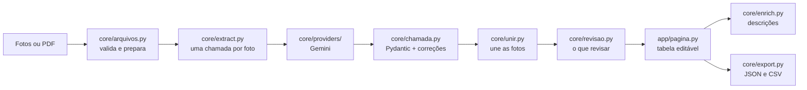

# Cardápio Instantâneo

[](https://github.com/leuuh/instant-menu-with-ia/actions/workflows/ci.yml)

Transforma fotos de um cardápio físico em um cardápio digital estruturado, editável e exportável,
usando um LLM multimodal. O sistema não deveria inventar preço: item com preço ilegível ou leitura
incerta vai para revisão humana antes de qualquer exportação.



## O problema

Donos de restaurantes pequenos levam horas para cadastrar o cardápio em apps de delivery, item por
item. O Cardápio Instantâneo recebe até 5 fotos (ou 1 PDF) e devolve, em segundos, um cardápio com
categorias, itens, preços, variações, adicionais e alergênicos prováveis. A revisão fica a cargo do
dono: o sistema destaca o que precisa ser conferido e nunca troca um preço por conta própria.

## Demo

Link público: https://instant-menu-with-ia-dnfvhjf83ewu5xwqj4kqs7.streamlit.app/

Na versão pública, a leitura com IA pede uma senha, porque a chave da API tem custo. Sem a senha, o
botão **Ver um exemplo pronto** abre um cardápio fictício já lido pela IA, com o mesmo fluxo de
revisão, edição e exportação, sem nenhuma chamada.

## Como funciona

1. **Leitura:** cada foto vai, em paralelo, para o modelo na resolução máxima, com um JSON Schema gerado do Pydantic. Se a resposta não passa na validação, o erro volta ao modelo até 2 vezes.
2. **União:** as leituras das várias fotos se juntam sem itens repetidos. Se duas fotos discordam sobre um preço, ele fica vazio e os dois valores vão para o dono.
3. **Revisão:** itens com confiança abaixo de 0,9 ou sem preço ficam destacados. O dono corrige na tabela e marca **Conferido**.
4. **Descrições sugeridas (opcional):** texto mais atrativo ao lado do original. Uma checagem em código descarta sugestões que inventam números, alergênicos ou adjetivos, ou que removem um alergênico do original.
5. **Exportação:** JSON, ou CSV pronto para o Excel em português. Itens pendentes ficam marcados.

O painel mostra o tempo e o custo estimado de cada cardápio, por etapa.

## Arquitetura



O provedor de LLM fica isolado em `core/providers/`, e trocar de modelo é uma linha no `.env`. Os
prompts são arquivos versionados em `prompts/`, e o hash de cada um vai para o log de cada chamada.

## Resultados

Avaliação de 03/11/2026 em 9 cardápios (205 itens), com 3 execuções por modelo
([relatório completo](evals/resultados/2026-11-03_1504/relatorio.md)):

| Modelo | Recall de itens | Precisão de itens | Preço correto | Preço errado sem aviso | Ilegível com preço e sem aviso | Custo médio | Falhas |
|---|---|---|---|---|---|---|---|
| gemini-3.5-flash-lite | 98,7% | 99,0% | 100% (569/569) | 0 | 5 de 38 | US$ 0,0069 | 0 de 27 |
| gemini-3.6-flash | 92,7% | 95,6% | 100% (232/232) | 0 | 1 de 9 | US$ 0,0149 | 14 de 27 (cota) |

- **Modelo escolhido:** o `gemini-3.5-flash-lite`, que foi o único a completar todas as execuções e custa menos da metade. O `gemini-3.6-flash` estourou a cota diária gratuita no meio da rodada, então a comparação ficou incompleta.
- **Ponto fraco:** preço ilegível ainda recebe um valor. Foram 5 casos sem aviso, em uma foto desbotada e em um preço coberto por uma figura. O limite de revisão pegou os outros 33.
- **Base pequena:** só o cardápio simulado está em português. Quatro gabaritos partiram de extrações do próprio `flash-lite`, o que pode favorecê-lo. Os detalhes estão em [docs/decisoes.md](docs/decisoes.md).

## Decisões técnicas

As principais, com as medições que as motivaram (todas em [docs/decisoes.md](docs/decisoes.md)):

- **Resolução máxima por imagem:** a resolução padrão fazia o modelo errar preços com confiança alta em fotos reais. O custo extra é menor que US$ 0,001 por foto.
- **Limite de revisão em 0,9, e não 0,7:** itens com preço borrado vinham com confiança 0,7 a 0,85 e escapavam da revisão.
- **Uma chamada por foto, unida em código:** uma foto ruim não derruba as outras, e a remoção de repetidos é testável. A regra é conservadora: um repetido que escapa fica visível, mas dois itens diferentes unidos fariam um preço sumir.
- **Preço em `Decimal`, ilegível = `null`, nunca 0:** a comparação de preço nos evals é exata.
- **Modelo próprio para as descrições:** o `flash-lite` empobrecia o texto. O `gemini-3.6-flash` mantém os detalhes, com custo maior só nessa etapa.
- **Regras de prompt testadas e descartadas:** exigir `null` para dígito ilegível não mudou nada em 12 execuções comparadas.

## Instalação

Requer Python 3.11 ou mais novo (o CI testa 3.11 e 3.13) e uma chave da API do Gemini
([aistudio.google.com/apikey](https://aistudio.google.com/apikey)).

```bash
git clone https://github.com/leuuh/instant-menu-with-ia.git
cd instant-menu-with-ia
python -m venv .venv
.venv\Scripts\activate        # Linux/macOS: source .venv/bin/activate
pip install -r requirements-dev.txt
copy .env.example .env        # Linux/macOS: cp .env.example .env
```

Preencha `GEMINI_API_KEY` no `.env`. A chave nunca vai para o git.

## Uso

```bash
streamlit run streamlit_app.py                                   # interface
python -m core.cli extrair foto1.jpg foto2.jpg --saida cardapio.json
```

## Avaliação e testes

```bash
python -m pytest                    # testes offline, sem chamar a API
python -m pytest -m live            # API real: exige chave no .env
ruff check . && ruff format --check . && mypy core tests evals app streamlit_app.py

python -m evals.run_evals --modelos gemini-3.5-flash-lite gemini-3.6-flash --repeticoes 3
python -m evals.run_evals --reavaliar evals/resultados/<pasta>   # só recalcula, sem API
python -m evals.run_evals --retomar evals/resultados/<pasta>     # refaz o que falhou
```

Os gabaritos ficam em `evals/data/gabaritos/`. As fotos reais (Wikimedia Commons, licenças livres)
são baixadas para `evals/cache/` na primeira execução e não vão para o repositório.

## Estrutura

```
app/            interface Streamlit, proteções da versão pública e exemplo pronto
core/           schema, provedores, extração, união, revisão, descrições, exportação, preços
prompts/        prompts versionados
evals/          avaliação, gabaritos e resultados salvos
tests/          testes offline (mais os marcados como live)
docs/           briefing, decisões técnicas e guia de deploy
```

Para continuar o desenvolvimento: briefing e fases em [docs/projeto.md](docs/projeto.md), e
instruções para o Claude Code em `CLAUDE.md`.
